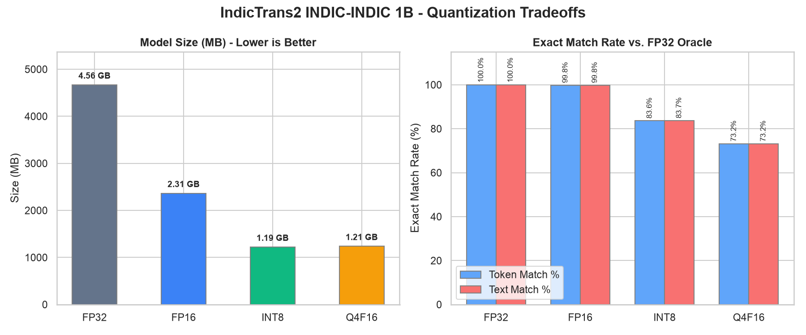
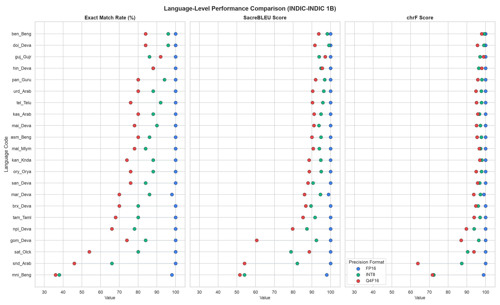
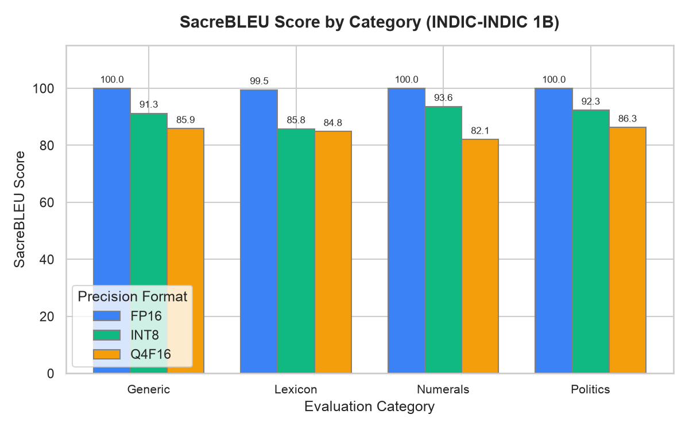

# IndicTrans2 1B (indic→indic) — ONNX bundle [INT8 (Dynamic Quantization)]

> [!TIP]
> This model is part of a suite of optimized/quantized ONNX versions of the base model.
> Other variants in this direction:
> - **FP32 (Full Precision / Base)**: [`hari31416/indictrans2-indic-indic-1B-ONNX`](https://huggingface.co/hari31416/indictrans2-indic-indic-1B-ONNX)
> - **FP16 (Half Precision)**: [`hari31416/indictrans2-indic-indic-1B-ONNX-fp16`](https://huggingface.co/hari31416/indictrans2-indic-indic-1B-ONNX-fp16)
> - **INT8 (Dynamic Quantization)**: [`hari31416/indictrans2-indic-indic-1B-ONNX-int8`](https://huggingface.co/hari31416/indictrans2-indic-indic-1B-ONNX-int8) *(Current)*
> - **Q4F16 (4-bit Block Quantization)**: [`hari31416/indictrans2-indic-indic-1B-ONNX-q4f16`](https://huggingface.co/hari31416/indictrans2-indic-indic-1B-ONNX-q4f16)

ONNX-exported and quantized version of [`ai4bharat/indictrans2-indic-indic-1B`](https://huggingface.co/ai4bharat/indictrans2-indic-indic-1B)
for in-browser and local edge inference.

- **Precision**: INT8 (Dynamic Quantization)
- **Description**: Dynamic INT8 quantization of the encoder and decoder. Highly recommended for CPU environments.
- **Source Pipeline & Details**: For pipeline details, benchmarks, and usage instructions, see the [indictrans2-onnx-export GitHub repository](https://github.com/Hari31416/indictrans2-onnx-export).

Built for use with [Transformers.js](https://github.com/huggingface/transformers.js)
and [onnxruntime-web](https://onnxruntime.ai/docs/get-started/with-javascript.html)
in the browser, with fast BPE tokenizer.json files that don't require the
SentencePiece WASM runtime.

## Performance Visualizations

These charts show overall tradeoffs, language-level parity, and category breakdown.





## Performance Tradeoffs & Size Comparison

Compared against the FP32 ONNX oracle on the golden evaluation fixtures.

| Format | Model Size | Exact Match (Token) | Exact Match (Text) | SacreBLEU (Raw) | Latency (Mean) | Speedup vs. FP32 |
| :--- | :--- | :--- | :--- | :--- | :--- | :--- |
| FP32 | 7.03 GB | 100.00% | 100.00% | 100.00 | 94.7 ms | 1.000x |
| FP16 | 3.52 GB | 99.82% | 99.82% | 100.00 | 108.3 ms | 0.874x |
| INT8 | 1.76 GB | 83.64% | 83.73% | 94.22 | 43.7 ms | 2.240x |
| Q4F16 | 900.0 MB | 73.18% | 73.18% | 89.33 | 94.2 ms | 1.087x |

## Language-Level Parity (INT8)

Exact match rates and translation quality (SacreBLEU / chrF) per language pair under this precision:

| Language Code | Total Fixtures | Token Match Rate | Text Match Rate | SacreBLEU | SacreBLEU (chrF) |
| :--- | :--- | :--- | :--- | :--- | :--- |
| **asm_Beng** | 50 | 86.0% | 86.0% | 94.87 | 97.69 |
| **ben_Beng** | 50 | 96.0% | 96.0% | 98.16 | 99.26 |
| **brx_Deva** | 50 | 80.0% | 80.0% | 89.49 | 96.04 |
| **doi_Deva** | 50 | 96.0% | 96.0% | 99.04 | 99.07 |
| **gom_Deva** | 50 | 84.0% | 84.0% | 92.34 | 96.30 |
| **guj_Gujr** | 50 | 86.0% | 86.0% | 93.82 | 97.02 |
| **hin_Deva** | 50 | 88.0% | 88.0% | 94.85 | 96.34 |
| **kan_Knda** | 50 | 88.0% | 88.0% | 94.76 | 97.98 |
| **kas_Arab** | 50 | 88.0% | 88.0% | 94.88 | 96.68 |
| **mai_Deva** | 50 | 90.0% | 90.0% | 93.74 | 97.16 |
| **mal_Mlym** | 50 | 84.0% | 86.0% | 93.90 | 97.31 |
| **mar_Deva** | 50 | 86.0% | 86.0% | 94.54 | 97.21 |
| **mni_Beng** | 50 | 38.0% | 38.0% | 54.09 | 72.29 |
| **npi_Deva** | 50 | 78.0% | 78.0% | 87.37 | 93.85 |
| **ory_Orya** | 50 | 88.0% | 88.0% | 94.91 | 97.79 |
| **pan_Guru** | 50 | 94.0% | 94.0% | 96.84 | 98.00 |
| **san_Deva** | 50 | 84.0% | 84.0% | 90.62 | 96.80 |
| **sat_Olck** | 50 | 80.0% | 80.0% | 78.79 | 90.34 |
| **snd_Arab** | 50 | 66.0% | 66.0% | 82.16 | 87.27 |
| **tam_Taml** | 50 | 80.0% | 80.0% | 91.63 | 97.02 |
| **tel_Telu** | 50 | 92.0% | 92.0% | 95.85 | 97.76 |
| **urd_Arab** | 50 | 88.0% | 88.0% | 96.35 | 97.71 |

## Category-Level Parity (INT8)

Exact match rates and translation quality grouped by category types:

| Category | Total Fixtures | Token Match Rate | Text Match Rate | SacreBLEU | SacreBLEU (chrF) |
| :--- | :--- | :--- | :--- | :--- | :--- |
| **Generic** | 286 | 84.6% | 84.6% | 91.26 | 94.60 |
| **Lexicon** | 264 | 79.9% | 80.3% | 85.80 | 92.89 |
| **Numerals** | 264 | 84.1% | 84.1% | 93.63 | 96.73 |
| **Politics** | 286 | 85.7% | 85.7% | 92.32 | 96.38 |

## Translation Mismatch Examples

Here is a sample of up to 5 translation mismatches compared to the FP32 oracle. Many mismatches represent minor synonym differences or spacing variations.

### Mismatch #1 (Category: Politics)
- **Source (asm_Beng → ben_Beng)**: `অনুগ্ৰহ কৰি পৰৱৰ্তী সোমবাৰৰ ভিতৰত সম্পূৰ্ণ কৰা কামটো দাখিল কৰক।`
- **Expected (FP32)**: `দয়া করে পরবর্তী সোমবারের মধ্যে কাজটি সম্পন্ন করুন।`
- **Actual (INT8)**: `দয়া করে পরবর্তী সোমবারের মধ্যে কাজটি সম্পূর্ণ করে জমা দিন।`

### Mismatch #2 (Category: Lexicon)
- **Source (asm_Beng → ben_Beng)**: `কোম্পানীটোৱে এক বন্ধুত্বপূৰ্ণ আৰু সহায়ক কৰ্ম পৰিৱেশ প্ৰদান কৰে।`
- **Expected (FP32)**: `সংস্থাটি একটি বন্ধুত্বপূর্ণ এবং সহায়ক কাজের পরিবেশ প্রদান করে।`
- **Actual (INT8)**: `কোম্পানিটি একটি বন্ধুত্বপূর্ণ এবং সহায়ক কাজের পরিবেশ প্রদান করে।`

### Mismatch #3 (Category: Lexicon)
- **Source (ben_Beng → brx_Deva)**: `পেট্রোলের দাম পাঁচ টাকা বেড়েছে।`
- **Expected (FP32)**: `पेट्रलनि बेसेना से रां बांदों।`
- **Actual (INT8)**: `पेट्रलनि बेसेना रू।`

### Mismatch #4 (Category: Generic)
- **Source (ben_Beng → brx_Deva)**: `ভালো বৃষ্টিপাতের কারণে ফসলের ফলন বেড়েছে।`
- **Expected (FP32)**: `मोजां अखानि जाहोनाव आबाद दिहुनथाया बांदों।`
- **Actual (INT8)**: `मोजां अखाया आबाद दिहुनथायाव बांहोदोंमोन।`

### Mismatch #5 (Category: Generic)
- **Source (ben_Beng → brx_Deva)**: `আগামী মাস থেকে এই নতুন নীতি কার্যকর হবে।`
- **Expected (FP32)**: `गोदान खान्थिया फैगौ दाननिफ्राय बाहायजागासिनो।`
- **Actual (INT8)**: `गोदान खान्थिया फैगौ दाननिफ्राय बाहायजागोन।`


## Files

- `encoder_model.onnx` (and optional `.onnx.data` weights sidecar)
- `decoder_model.onnx` and `decoder_with_past_model.onnx` (share `decoder_shared.onnx.data` when present)
- `translate.py` — self-contained Python inference helper (see Usage below)
- Fast tokenizer config files (`tokenizer_src.json`, `tokenizer_tgt.json`, `tokenizer_meta.json`)
- Model configuration configs (`config.json`, `generation_config.json`)

## Usage Example (Python, onnxruntime)

```python
# translate.py is included in this repo alongside the ONNX bundle.
# You can also find it (and read the full source) at:
#   https://github.com/Hari31416/indictrans2-onnx-export/blob/main/src/translate.py

from translate import IndicTransONNX

# Pass a HF repo ID for automatic download, or a local bundle directory path
model = IndicTransONNX("hari31416/indictrans2-indic-indic-1B-ONNX-int8")
print(model.translate("चुनाव कौन जीतेगा?", src_lang="hin_Deva", tgt_lang="tam_Taml"))
```

Required packages:

```bash
pip install onnxruntime tokenizers huggingface-hub
```

## License

MIT (preserved from upstream AI4Bharat).
